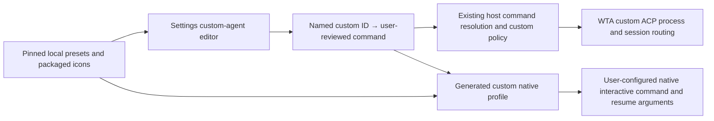

# ACP registry agent presets

## User experience and boundaries

In **Settings → AI agents → Agent → + Add New…**, select an **ACP Registry**
preset, review its command and linked provider setup, then save. Choosing a
preset alone does not install or launch anything. Package commands may download
and run third-party software when the saved agent is prepared/used. Installation,
credentials, subscriptions and provider authentication remain provider-owned.
Registry inclusion is not a compatibility certification.

The local catalog is pinned to
[`agentclientprotocol/registry@2a27ff18b5816f47d7ec538e22943ff194e05131`](https://github.com/agentclientprotocol/registry/tree/2a27ff18b5816f47d7ec538e22943ff194e05131).
There is **no runtime remote catalog**, automatic registry update, binary
installer, new authentication integration or session hook. Existing built-ins
and handwritten custom commands retain their behavior.

All 42 non-quarantined entries are discoverable; 20 plain package launches can
be filled automatically. Archive-based or environment-dependent entries instead
require an explicit installed command. We do not guess an executable on PATH,
drop required environment variables, or turn a relative archive path into a
Windows installation path. An entry with a blank command cannot be saved until
the user supplies one. Use the linked pinned manifest's complete `args` and
`env`, provider installation instructions, and an explicitly configured wrapper
when per-process environment is needed.

The presets configure the existing **host** custom-ACP command setting.
Linux availability in the research table is not automatic WSL configuration:
the user must explicitly configure the WSL executable/distro, Linux install and
working directory. No Windows command is silently translated into a WSL command.

## Stable custom identities, not additional built-ins

Legacy custom IDs derive from the executable basename. Storing two npm presets
in the old string list would replace both with `custom:npx`. Changing that
derivation would also change existing profile GUIDs and session identities.
Instead, an additive map binds explicit custom IDs to commands:

```json
{
  "acpAgent": "custom:acp-registry-bob",
  "acpNamedCustomCommands": {
    "custom:acp-registry-bob": "npx --yes @ibm/bob@2.1.0 acp",
    "custom:acp-registry-cline": "npx --yes cline@3.0.75 --acp"
  }
}
```

Changing a named command/version preserves its ID. Existing `acpCustomCommands`
and legacy `acpCustomCommand` remain supported. A selected named entry owns its
singular compatibility mirror; that mirror is not reinserted as `custom:npx`.
Keep independently configured legacy entries in the plural legacy collection.
All registry entries remain **custom** for `AllowCustomAgents` policy and
telemetry; they are not additions to the built-in `AllowedAgents` identifiers.
Do not configure the same explicit ID in both named and legacy inventories:
the named binding is authoritative.

Only canonical lowercase `custom:` IDs with an alphanumeric first/last
character and interior alphanumeric, `-`, `_`, `.` characters are accepted.
Built-in slugs, blank commands and embedded NUL characters are rejected. Commands are
user-trusted executable configuration, not a sandbox.



## Profiles, icons and resume

Every configured valid registry binding generates a custom agent profile with
a stable GUID and the same agent artwork as its Settings choice. Existing
built-in artwork is reused for matching providers; other artwork is pinned,
packaged locally and accompanied by its registry license/provenance notices.
Monochrome alpha masks follow the UI foreground for light/dark/high-contrast
presentation. Provider names remain the accessible identity; tiny icons are
decorative, not the sole label.

**ACP launch is not native interactive launch.** An adapter or `vibe-acp` must
not become a shell profile's interactive command. Generated custom profiles
therefore initially require the user to configure the native command and, where
verified, `agentProfile.resumeArguments`. Profile availability is not gated on
adding hooks or discovering native history. No new native session scanning or
ACP-to-native identifier mapping is introduced.

`session/load` uses an ACP session ID and is negotiated with the running
provider. A native CLI resume flag may require a different ID, a file path, a
workspace-scoped ID, a picker or no argument at all. Never assume equality:
Amp explicitly persists separate `S-…` ACP IDs and `T-…` native thread IDs.
Existing custom ACP discovery/load support is retained; the current product
session-origin filter is unchanged.

## Complete pinned launch inventory

Each ID identifies its exact source manifest (the version, archive URL/hash,
platform-specific command, arguments and environment there are authoritative).
In the launch column, `npx P …` means `npx --yes P …`; `./…` is **relative to an
extracted archive**, not an install recommendation. Binary names in this compact
table are abbreviations; use the manifest's exact relative path. `P` means a
package distribution whose actual Windows/WSL runtime support remains
provider-dependent, not a verified cross-platform claim.

Binary availability: `W` = Windows x64, `WA` = Windows ARM64; `L` = Linux x64,
`LA` = Linux ARM64; `M` = corresponding musl builds. Linux targets may work in
a matching WSL distro; no WSL runtime was tested. Package rows do not imply
availability on every CPU/OS.

| Registry ID | Version | ACP stdio launch / required environment | Distribution availability | Prefill |
|---|---|---|---|---|
| agoragentic-acp | 1.3.0 | `npx agoragentic-mcp@1.3.0 --acp` | P | Quarantined |
| amp-acp | 0.13.0 | archive `amp-acp` | W,L,LA | Manual |
| antigravity-acp | 1.5.2 | Windows `agy_acp_server.exe`; Linux `agy_acp_server.par --uid=` | W,WA,L,LA | Manual |
| auggie | 0.37.0 | `npx @augmentcode/auggie@0.37.0 --acp`; `AUGMENT_DISABLE_AUTO_UPDATE=1` | P | Manual env |
| autohand | 0.9.12 | archive `autohand --acp` | W,L,LA,M | Manual |
| bob | 2.1.0 | `npx @ibm/bob@2.1.0 acp` | P | Yes |
| claude-acp | 0.110.0 | `npx @agentclientprotocol/claude-agent-acp@0.110.0` | P; L,LA,M binary alternative | Yes |
| cline | 3.0.75 | `npx cline@3.0.75 --acp` | P | Yes |
| codebuddy-code | 2.185.0 | `npx @tencent-ai/codebuddy-code@2.185.0 --acp` | P | Yes |
| codex-acp | 2.10.0 | `npx @agentclientprotocol/codex-acp@2.10.0` | P | Yes |
| cortex-code | 1.0.73 | archive versioned `cortex[.exe] acp serve` | W,WA,L,LA | Manual |
| corust-agent | 0.6.0 | archive `corust-agent-acp` | W,L | Manual |
| crow-cli | 0.1.49 | archive `crow-cli acp` | W,L,LA | Manual |
| cursor | 2026.11.22 | archive `dist-package/cursor-agent[.cmd] acp` | W,WA,L,LA | Manual |
| deepagents | 0.1.7 | `npx deepagents-acp@0.1.7` | P | Quarantined |
| devin | 3000.14.30821 | archive `bin/devin[.exe] acp` | W,WA,L,LA | Manual |
| dimcode | 0.5.32 | `npx dimcode@0.5.32 acp` | P | Yes |
| dirac | 0.6.1 | `npx dirac-cli@0.6.1 --acp` | P | Yes |
| factory-droid | 1.18.0 | `npx droid@1.18.0 exec --output-format acp-daemon`; `DROID_DISABLE_AUTO_UPDATE=true`, `FACTORY_DROID_AUTO_UPDATE_ENABLED=false` | P | Manual env |
| fast-agent | 0.10.65 | `uvx fast-agent-acp==0.10.65 -x`; `FAST_AGENT_MODEL=codexplan` | P | Manual env |
| gemini | 0.70.0 | `npx @google/gemini-cli@0.70.0 --acp` | P | Yes |
| github-copilot-cli | 1.0.114 | `npx @github/copilot@1.0.114 --acp` | P | Yes |
| github-copilot | 1.574.0 | `npx @github/copilot-language-server@1.574.0 --acp` | P | Yes |
| glm-acp-agent | 1.17.1 | `npx glm-acp-agent@1.17.1` | P | Yes |
| goose | 1.60.2 | archive `goose[.exe] acp` (Windows nested in `goose-package`) | W,L,LA,M | Manual |
| grok-build | 1.0.93 | `npx @xai-official/grok@1.0.93 agent stdio` | P | Yes |
| harn | 0.10.202 | archive `harn serve acp` | W,L,LA | Manual |
| junie | 4100.11.0 | archive `junie/junie.exe --acp=true`; Linux `junie-app/bin/junie --acp=true` | W,WA,L,LA | Manual |
| kilo | 7.8.32 | `npx @kilocode/cli@7.8.32 acp` | P; W,L,LA,M binary alternative | Yes |
| kimchi | 1.39.1 | archive `bin/kimchi --mode acp` | W,L,LA | Manual |
| kimi-code | 2.7.3 | `npx @moonshot-ai/kimi-code@2.7.3 acp` | P | Yes |
| kimi | 1.52.0 | archive `kimi[.exe] acp` | W,WA,L,LA | Manual |
| kiro | 3.0.0 | archive `kirocli/bin/kiro-cli acp --agent-engine=v3` | L,LA,M; no Windows binary | Manual |
| minimax-code | 0.7.9 | `npx @minimax-ai/code-acp@0.7.9 acp` | P | Yes |
| minion-code | 0.1.44 | `uvx minion-code@0.1.44 acp` | P | Quarantined |
| mistral-vibe | 3.1.4 | archive `vibe-acp[.exe]` | W,L,LA | Manual |
| muse-code | 1.4.24 | archive `muse[.exe] acp`; `MUSE_EXPERIMENTAL_ACP=on` | W,WA,L,LA | Manual env |
| nova | 1.1.68 | `npx @compass-ai/nova@1.1.68 acp` | P | Yes |
| opencode | 2.4.1 | archive `opencode[.exe] acp` | W,WA,L,LA,M | Manual |
| pi-acp | 0.0.35 | `npx pi-acp@0.0.35` | P | Yes |
| poolside | 1.0.16 | archive `pool-<platform>-<arch>[.exe] acp` | W,WA,L,LA | Manual |
| qoder | 1.1.96 | `npx @qoder-ai/qodercli@1.1.96 --acp` | P | Yes |
| qwen-code | 0.28.4 | `npx @qwen-code/qwen-code@0.28.4 --acp --experimental-skills` | P | Yes |
| sigit | 1.7.10 | `npx @smbcloud/sigit@1.7.10` | P; W,WA,L,LA binary alternative | Yes |
| stakpak | 0.3.88 | archive `stakpak[.exe] acp` | W,L,LA,M | Manual |
| vtcode | 0.96.14 | archive `vtcode acp`; `VT_ACP_ENABLED=1`, `VT_ACP_ZED_ENABLED=1` | W,L,M | Quarantined |

Manifest URL convention: `[registry]/<id>/agent.json`, where `[registry]` is the
pinned tree below. The machine-readable research matrix retains **every**
distribution object, including exact archive URLs/hashes, full paths, all args
and env, and platform keys. Reproduce it from the pinned source checkout:

```powershell
python build/scripts/Test-AcpAgentPresets.py `
  --registry '<pinned-registry-checkout>' `
  --revision 2a27ff18b5816f47d7ec538e22943ff194e05131 `
  --matrix 'Generated Files/acp-registry-delivery/research/matrix.json'
```

The checker verifies inventory/quarantine parity, all populated package commands
and pins, environment preservation, and shared packaged icon existence without
running any agent. Preview distributions are deliberately not selected.

### Research limits and sources

All 46 stable manifests and registry format/auth guidance were read; no registry
agent was installed or executed for this work. Authentication guidance requires
Agent Auth or Terminal Auth, but membership does not prove that our client
implements a particular provider's advertised flow. Terminal Auth setup args/env
**replace**, not append to, the normal ACP launch args/env. This feature adds
neither an auth implementation nor a claim that untested providers work.

Native resume research and explicit unsupported/unknown contracts:
[native session contracts](acp-registry-native-sessions.md).

[registry]: https://github.com/agentclientprotocol/registry/tree/2a27ff18b5816f47d7ec538e22943ff194e05131
[Registry format](https://github.com/agentclientprotocol/registry/blob/2a27ff18b5816f47d7ec538e22943ff194e05131/FORMAT.md)
· [Authentication contract](https://github.com/agentclientprotocol/registry/blob/2a27ff18b5816f47d7ec538e22943ff194e05131/AUTHENTICATION.md)
· [Quarantine](https://github.com/agentclientprotocol/registry/blob/2a27ff18b5816f47d7ec538e22943ff194e05131/quarantine.json)
