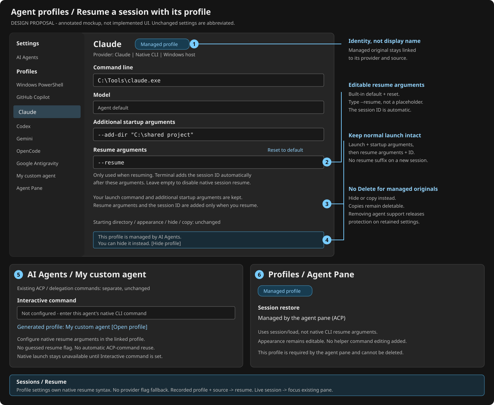

# Resume sessions with their agent profile

**Design proposal only.** No application behavior changes in this PR.
Review the annotated mockup and the layer table; implementation follows separately.

Today, editing an agent profile does not reliably affect how a historical session
reopens. Generated agent profiles can also be deleted, and agents added in
AI Agents settings do not receive corresponding profiles.



## Proposed UI and behavior

| Annotation | Change |
| --- | --- |
| 1 | Show the provider and a **Managed profile** badge. Keep identity independent of the editable display name. |
| 2 | Add **Resume arguments** below additional startup arguments. Enter only the argument or verb, such as `--resume` or `resume`. Hint: **Only used when resuming. Terminal adds the session ID automatically after these arguments.** No placeholder input and no command preview. Built-ins inherit profile defaults with reset/inheritance affordances; an empty override disables native resume. |
| 3 | The help text explains composition: **Your launch command and additional startup arguments are kept. Resume arguments and the session ID are added only when you resume a session.** This is explanatory text, not another control. |
| 4 | Replace Delete with **This profile is managed by AI Agents. You can hide it instead.** Keep appearance, hide, and copy controls. Protect the managed original, not user-created copies. |
| 5 | Each custom agent saved in AI Agents gets one corresponding managed profile. Link to it from the custom-agent editor. Native launch and resume commands must be explicitly configured; an ACP command is not assumed to be an interactive CLI command. |
| 6 | Protect the existing **Agent Pane** profile too. Show **Session restore: Managed by the agent pane (ACP)** instead of native resume arguments. Do not expose helper pipes, window IDs, or native startup flags here. |

These are additions to the current profile page, not a replacement settings UI.
The mockup abbreviates unchanged controls. "Resume" means reopen a particular
conversation; it does not mean always resume the latest session on ordinary
new-tab launch, splitting, or when Sessions is off.

## Launch contract

Proposed inheritable profile key: `agentProfile.resumeArguments`.
Store only the arguments preceding the session ID, not a template, second
executable, shell script, or conversation ID:

```jsonc
{
    "agentProfile.id": "claude",
    "agentProfile.model": "",
    "agentProfile.arguments": "--add-dir \"C:\\shared project\"",
    "agentProfile.resumeArguments": "--resume"
}
```

An omitted value inherits the profile default. An explicit empty string means
native resume is unavailable. The UI shows the automatic-ID hint beside the
field; users never type `{sessionId}`. Parse resume arguments using the same
argument rules as additional startup arguments, then append the validated,
opaque session ID as one argument. Use the existing executable/batch/WSL quoting
helpers; never evaluate arguments as script text. Malformed or unsafe arguments
produce an inline error and a launch-time error.

| Built-in provider | Default resume arguments (current repository contract) |
| --- | --- |
| GitHub Copilot | `--resume` |
| Claude | `--resume` |
| Codex | `resume` |
| Gemini | `--resume` |
| OpenCode | `--session` |
| Google Antigravity | `--conversation` |
| Custom agent | Empty until configured; never guess built-in syntax |

These defaults reflect `tools/wta/src/agent_registry.rs:130-294`, not a claim that
every installed CLI version has been live-verified. Implementation must check
the supported CLI versions, including option ordering and adapter/native history
compatibility. Antigravity currently cannot resume ACP conversations via its CLI.

### One launch command, with a resume-only suffix

```text
Normal launch = profile launch command + additional startup arguments
Resume        = the same normal launch + profile resume arguments + session ID
```

The managed launch command includes the resolved executable and existing
structured model/permission options. Additional startup arguments are included
exactly once. Resume adds only the suffix; an ordinary new tab or split never
receives it. For example, the profile above launches
`claude --add-dir "C:\shared project"` normally, and
`claude --add-dir "C:\shared project" --resume <actual-session-id>` on resume.
Codex uses the identical composition with profile value `resume`, not a
provider-specific branch. Verify supported CLI option ordering with executable
fixtures and live CLI help before implementation ships.

Terminal owns effective profile resolution and this generic composition.
Resolve the profile's executable again at launch; preserve model, permission
mode, extra arguments, environment, appearance, and close-on-exit behavior.
Resume selection belongs in the resume field, not additional startup arguments;
do not add a per-provider flag parser to guess user intent.

### Profile data is the only native resume syntax source

Put the six defaults above in generated-profile entries in
`src/cascadia/TerminalSettingsModel/defaults.json`, keyed by their stable
generated GUID/source and provider identity. Layer user overrides through the
normal profile settings mechanism. Do not introduce a second provider-to-flag
map in C++ or Rust. Provider discovery/allowlists remain code; how to resume is
profile data.

Remove `ResumeInvocations`/`BuildResumeCommandline` native syntax selection from
`src/cascadia/inc/AgentPaneRestore.h`, and `resume_flag` from WTA's
`tools/wta/src/agent_registry.rs`. Replace native command synthesis in Sessions,
sidebar activation, coordinator, and saved-layout restoration with profile
resolution plus this composition. Missing/empty resume settings report
unavailable; there is no hardcoded flag fallback, even for legacy history or WSL.
WTA routing consumes effective resume availability from Terminal instead of
inferring it from a built-in ID. ACP `session/load` stays a protocol capability,
not CLI syntax.

An explicit profile `commandline` remains an override: use that base command
unchanged as normal launch already does, and do not resurrect hidden structured
model/permission/extra arguments. Resume adds the effective profile resume
arguments and automatic ID to that same base. The profile owner must configure
arguments appropriate to an edited command; no runtime provider-based
replacement occurs. Existing explicit new-tab/action overrides keep their
precedence. This proposal does not change ordinary command-override behavior.

For custom agents, generate a stable profile for each canonical `custom:<id>`
across the saved ACP/delegation entries, deduplicating only identical IDs.
Add a distinct **Interactive command** field to their AI Agents editor, mapped
to the generated profile's command line; leave it unconfigured initially.
The generated profile remains editable but is not offered as launchable until
that command is set. Explain this state and link to its configuration.
Do not run an ACP server or a prompt-bearing delegation command as a native TUI.
Changing/removing a custom command must reconcile its existing command-derived
identity explicitly; do not silently attach an old profile to a different agent.

## Matching sessions and profile lifetime

Record the originating profile GUID alongside the qualified session identity
(provider, host/WSL distro, and existing session-universe identity). Resuming a
known session uses that GUID after validating provider and execution location,
not the profile name, a command-string heuristic, or the global default profile.
This keeps user-created project-profile copies distinguishable.

For imported history with no profile GUID, resolve the canonical generated
profile's settings using qualified provider/location identity. Host sessions
launch the matching host profile. Legacy WSL history retains its exact distro
and Linux cwd: bind the provider profile's resume settings to that WSL execution
context, resolving the executable inside the distro, never reusing a host
executable path or Windows environment. An existing source-qualified WSL profile
takes precedence. This preserves WSL history without adding automatic WSL profile
discovery or retaining hardcoded resume flags. If settings or a compatible
launcher are unavailable, show a matching-profile chooser/configuration action;
never open a default shell or use another location.
Unavailable stored directories retain the existing reported fallback to the
selected profile's directory.

Live sessions still focus their existing pane. ACP-origin sessions retain
capability-gated `session/load`, the selected provider/source/model, and the
protected Agent Pane profile. Native resume arguments cannot override ACP loading
or make a native-only custom agent ACP-capable. Hook availability does not gate
history listing or resume.

Protect generated originals while their built-in provider remains supported or
their custom agent remains configured. Missing executables and policy blocks
make them unavailable, not deletable or silently replaced. Removing support or
deleting the custom-agent entry releases protection on retained orphaned settings;
do not discard overrides automatically. The internal Agent Pane profile remains
protected independently. Enforce this in the delete handler as well as the UI,
and reconcile old generated-profile deletion tombstones so supported originals
return with their overrides intact. User-created copies remain deletable.

## Required implementation files

Every path below is relative to the repository root. This is the future runtime
implementation map; this PR itself changes only this document and its SVG mockup.

| Layer | Exact files | What changes / why |
| --- | --- | --- |
| Default profile data | `src/cascadia/TerminalSettingsModel/defaults.json` | Add `agentProfile.resumeArguments` to the six stable generated-profile entries. Provider-specific resume syntax lives here, not in runtime maps. Keep the internal Agent Pane profile separate. |
| Profile setting / schema | `src/cascadia/TerminalSettingsModel/MTSMSettings.h`; `doc/cascadia/profiles.schema.json` | Add the inheritable string, automatic-ID help, and empty/reset semantics. Existing profile macros project/serialize it. |
| Generic launch assembly | `src/cascadia/inc/AgentProfileUtils.h` | Reuse normal launch assembly; append parsed effective resume arguments and the quoted ID only for resume intent. No provider-to-resume-flag branch. |
| Generated/custom profile lifecycle | `src/cascadia/TerminalSettingsModel/AgentProfileGenerator.cpp`; `src/cascadia/TerminalSettingsModel/AgentProfileGenerator.h`; `src/cascadia/TerminalSettingsModel/CascadiaSettingsSerialization.cpp`; `src/cascadia/TerminalSettingsModel/CascadiaSettings.cpp` | Reconcile custom entries after settings load, preserve GUIDs/overrides, restore previously suppressed supported originals, and expose shared managed-original eligibility. |
| Profile editor / delete handler | `src/cascadia/TerminalSettingsEditor/Profiles_Base.xaml`; `src/cascadia/TerminalSettingsEditor/ProfileViewModel.cpp`; `src/cascadia/TerminalSettingsEditor/ProfileViewModel.h`; `src/cascadia/TerminalSettingsEditor/ProfileViewModel.idl`; `src/cascadia/TerminalSettingsEditor/MainPage.cpp` | Bind resume arguments and hints/reset, omit preview, show protection, and enforce it in deletion. Copies stay deletable. |
| Custom-agent editor | `src/cascadia/TerminalSettingsEditor/AIAgents.xaml`; `src/cascadia/TerminalSettingsEditor/AIAgents.cpp`; `src/cascadia/TerminalSettingsEditor/AIAgentsViewModel.cpp`; `src/cascadia/TerminalSettingsEditor/AIAgentsViewModel.h`; `src/cascadia/TerminalSettingsEditor/AIAgentsViewModel.idl` | Add the native Interactive command and linked-profile action; keep ACP/delegation commands separate. |
| UI resource source | `src/cascadia/TerminalSettingsEditor/Resources/en-US/Resources.resw` | Add accessible resume-field hints, validation, custom-command, and protection text; propagate translations through the existing localization workflow. |
| Remove duplicate native syntax | `src/cascadia/inc/AgentPaneRestore.h`; `tools/wta/src/agent_registry.rs`; `tools/wta/src/coordinator.rs` | Remove the native resume invocation table, registry `resume_flag`, and provider-based resume synthesis. Keep ACP capabilities and unrelated delegation behavior. |
| Both history activation callers | `tools/wta/src/app.rs`; `tools/wta/src/master/mod.rs`; `tools/wta/src/session_mgmt.rs` | Sessions and sidebar pass typed profile/session intent; reducers consume effective resume availability instead of built-in flags. Never fall back to hardcoded native syntax. |
| Session identity/storage | `tools/wta/src/agent_sessions.rs`; `tools/wta/src/session_registry.rs`; `src/cascadia/TerminalApp/TerminalPage.cpp`; `src/cascadia/TerminalApp/TerminalPage.h` | Carry optional originating profile GUID beside qualified identity; validate provider/source, preserve copies and old records, and resolve legacy WSL bindings without host-path reuse. |
| Terminal launch boundary | `src/cascadia/TerminalProtocol/TerminalProtocol.idl`; `src/cascadia/WindowsTerminal/TerminalProtocolComServer.cpp`; `src/cascadia/TerminalApp/TerminalPage.Protocol.cpp`; `src/tools/wtcli/main.cpp`; `tools/wta/src/shell/wt_channel/cli_channel.rs` | Carry typed resume intent to Terminal profile resolution and return actual launch errors/receipts. If a new COM operation is needed, version the interface without changing existing slots. |
| Saved-layout restoration | `src/cascadia/TerminalApp/TabManagement.cpp`; `src/cascadia/TerminalApp/TerminalPage.cpp`; `src/cascadia/inc/AgentPaneRestore.h` | Save profile/session intent rather than synthesizing provider commands; restore with effective profile data. Preserve ACP `session/load` and legacy layout compatibility. |
| Regression coverage | `src/cascadia/UnitTests_SettingsModel/CustomAgentAndPolicyTests.cpp`; `src/cascadia/UnitTests_SettingsModel/TerminalSettingsTests.cpp`; `src/cascadia/LocalTests_TerminalApp/TabTests.cpp`; `tools/wta/src/app_tests.rs`; `tools/wta/src/master/tests.rs`; `tools/wta/src/coordinator.rs` | Assert normal versus resume argv, data-default overrides, custom lifecycle/protection, both activation routes, and restart/WSL identity. |
| Live coverage / user docs | `test/e2e/tests/Feature.CustomAgent.Tests.ps1`; `test/e2e/tests/Feature.CombinedAgentsSidebar.Tests.ps1`; `test/e2e/tests/Feature.WslAgentBackend.Tests.ps1`; `doc/agent-profiles.md` | Verify custom/profile routing and launch composition end-to-end; document profile-owned restore behavior and automatic session ID. |

## Implementation acceptance

Use executable fixtures to capture argv, environment, profile GUID, and cwd for
all six built-ins plus one custom agent. Assert additional startup arguments
appear once in both normal and resume launches, with resume arguments and the
automatic ID present only in resume. Change a profile's resume arguments to a
fixture-specific value and prove all native restore routes use it without a
provider fallback. Cover spaces, malformed arguments, batch shims, Codex ordering,
missing executables, policy blocks, and explicit
command overrides. Test two copies of one provider profile and older history
without a GUID. Exercise Sessions, sidebar, and saved-layout restoration.
Verify protected deletion through the UI and handler, custom removal/re-add,
old suppression state, and unsupported-provider cleanup. Preserve live focus,
ACP loading, Sessions-OFF behavior, hook-less resume, and existing WSL routing.

No runtime, deployment, hook installation, or settings migration is performed
by this proposal.
